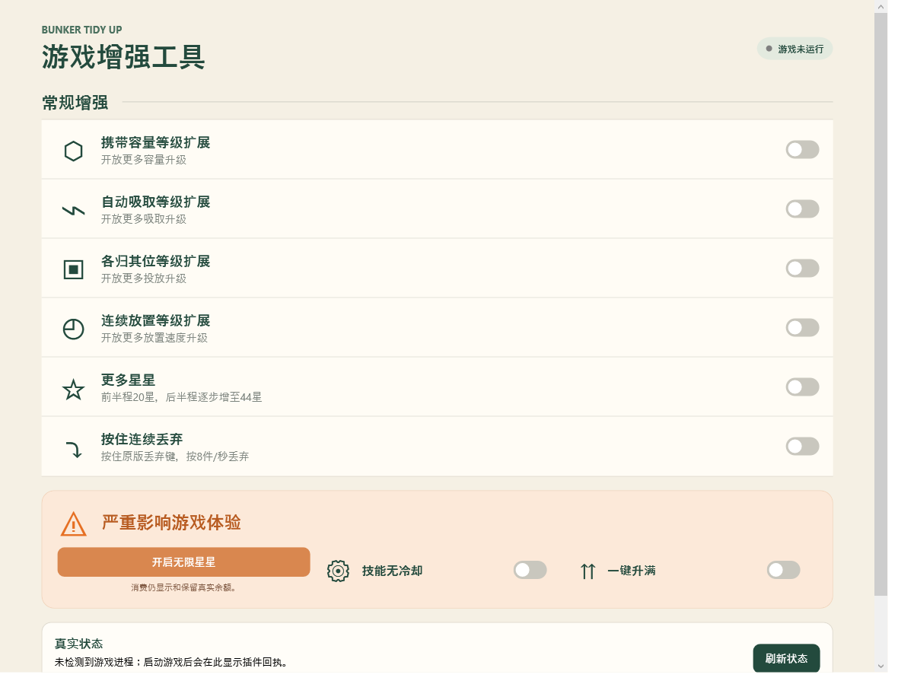

# Bunker Tidy Up 游戏增强工具

**v1.0.4 · Windows x64 · 简体中文**

为 Bunker Tidy Up（碉堡大扫除）提供容量和技能等级扩展、更多星星、按住拾取与丢弃等功能。包含桌面控制器与随游戏自动加载的插件；配置保存后，无需让控制器一直开着。

**1.0.4 更新：适配 10 月 23 日游戏更新（Steam Build 26103693），修复新版笔记、游玩统计恢复与旧读档补丁的冲突。功能、界面及修改器数值保持原样。**

## 下载

| 版本 | 下载 | 使用方式 |
| --- | --- | --- |
| Windows 安装程序 | [BunkerTidyUpTrainer-1.0.4-Setup.exe](https://github.com/loaye1203/BunkerTidyUpTrainer/releases/download/v1.0.4/BunkerTidyUpTrainer-1.0.4-Setup.exe) | 安装桌面工具，支持从旧版升级。 |
| 便携版 | [BunkerTidyUpTrainer-1.0.4-Portable.zip](https://github.com/loaye1203/BunkerTidyUpTrainer/releases/download/v1.0.4/BunkerTidyUpTrainer-1.0.4-Portable.zip) | 完整解压后运行，无需安装桌面工具。 |

也可从 [Releases 页面](https://github.com/loaye1203/BunkerTidyUpTrainer/releases/latest)进入 **Assets** 下载。选择 `Setup.exe` 或 `Portable.zip`；`Source code` 是源码包。

两种发行包均包含控制器、游戏插件和所需运行文件，玩家无需另装 .NET。



## 安装与升级

1. **完全退出游戏**，安装新版桌面工具，或将便携包解压到一个完整目录。
2. 运行 `BunkerTidyUpTrainer.exe`，选择包含 `Bunker.exe` 的游戏根目录。
3. 点击 **安装 / 检查**，完成游戏插件的部署或更新。
4. 启动游戏并载入存档，再按需开启功能。

从旧版升级也需要执行第 3 步：只更新桌面程序不会自动替换游戏里的插件。安装检查会保留已有开关配置与扩展等级记录。首次安装时所有功能默认关闭。

工具会识别支持的已有加载器和本工具残留，备份相关文件后补齐缺失项、修复安装记录。已有其他模组、未知加载器或修改过的组件需要按具体提示处理；遇到 `winhttp.dll` 不必先自行删除。

## 功能

| 功能 | 说明 |
| --- | --- |
| 携带容量等级扩展 | 开放更多容量升级；达到 10 级后可按住原拾取动作持续范围拾取。 |
| 自动吸取等级扩展 | 开放更高等级，提升吸取数量并缩短新增等级的冷却。 |
| 各归其位等级扩展 | 开放更高等级，保留原有货架匹配与逐件整理逻辑。 |
| 连续放置等级扩展 | 开放更高等级，提高新增等级的放置速率。 |
| 更多星星 | 按已经完成整理的物资种类数发放渐进奖励；不重复奖励已完成的种类。 |
| 按住连续丢弃 | 使用原版丢弃动作，按住后最多每秒丢弃 8 件，松开即停。 |
| 无限星星 | 购买免消费，同时保留真实余额；关闭后恢复正常扣费。 |
| 技能无冷却 | 去掉释放后的冷却等待，保留技能执行节奏与互斥。 |
| 一键升满 | 临时应用当前允许的最高等级；关闭后恢复真实购买等级。 |

常规模式下，携带容量最高 16 级、容量 200；自动吸取最高 15 级，各归其位及连续放置最高 10 级。原版等级和费用保留，扩展等级正常购买。详细规则见 [常规模式功能参数](docs/功能参数.md)。

简单模式使用该模式自身的原版等级、费用与物资数量，本版保留既有修改器参数，未重新平衡简单模式的奖励预算。

范围拾取遵守原版距离、遮挡、楼层和容量检查，不会从货架中取物；暂停、失焦或游戏 UI 锁定输入时停止。按住拾取使用原版拾取动作，不改变自动吸取技能的同类物品规则。

## 存档与关闭功能

配置与扩展等级记录保存在游戏目录的 `BepInEx/config/BunkerTidyUpTrainer/`。超出原版上限的真实购买等级按存档槽位单独保存；临时升满不会变成真实购买等级。

关闭扩展会恢复原版上限，但保留已经购买的扩展记录，再次开启无需重买。容量下降时已有手持物不会被删除；超过容量期间不能继续拾取，可以正常放置或丢弃。

迁移或备份存档时，请同时保留游戏的 `Saves` 目录及插件的 `settings.json`、`slots` 目录。

### 完整恢复并移除游戏插件

1. 在控制器中点击 **恢复原版并停用插件**。
2. 启动游戏，逐个载入需要保留的存档槽；将手持物整理到该档原版容量以内，再正常保存。
3. 完全退出游戏，回到控制器点击 **完成恢复并移除**。

控制器会核对各存档的保存记录、指纹和手持容量，未通过时会保留插件并提示对应原因。开始菜单或安装目录中的桌面卸载程序只移除控制器；游戏插件需通过上述流程恢复和移除。

## 常见问题

**安装新版后仍未生效？**

退出游戏，在新版控制器中确认游戏路径，重新点击 **安装 / 检查**，然后启动游戏并载入存档。

**显示“插件回执已过期”？**

它表示游戏进程存在，但插件的运行状态超过 5 秒未更新。先切回游戏正常运行几秒，再查看状态；若持续出现，关闭重复的控制器窗口并重启游戏。仍无效时，退出游戏后执行安装检查，并保留相关插件日志供排查。

**开启后可以关闭桌面工具吗？**

可以。设置保存并由插件应用后，游戏插件会自行运行。

## 兼容与验证范围

1.0.4 已使用 **Steam Build 26103693、Unity Mono 6000.0.59f2、Windows x64** 的新版游戏副本实际验证：

- 常规模式的扩展等级购买、临时升满、扩展开关恢复及保存回读。
- 常规模式和简单模式的非零游玩统计、笔记状态与新格式存档恢复。
- 两种模式的 New Game+：扩展等级和笔记保留、点数清零、模式与新周目标记正确保存。

完整说明见 [1.0.4 验证报告](docs/验证报告-1.0.4.md)和 [更新记录](docs/release-notes-1.0.4.md)。其他游戏版本、IL2CPP 和其他模组组合未作同等验证。

测试使用独立存档与测试身份。发行包不包含游戏原始程序集、场景资源或玩家存档；工具不会改写 `Bunker.dll` 或 Unity 游戏程序集。

## 从源码构建

需要 Windows、PowerShell 和仓库 `global.json` 指定的 .NET 10 SDK。

```powershell
git clone https://github.com/loaye1203/BunkerTidyUpTrainer.git
cd BunkerTidyUpTrainer
.\scripts\Build-Release.ps1 -GamePath "D:\Games\Bunker Tidy Up"
# 或使用 Unity 官方编译引用，无需安装游戏
.\scripts\Build-Release.ps1 -UnityVersion 6000.0.59
```

输出位于 `.artifacts/release/v1.0.4/`，包含安装程序、便携包、校验值与版本信息。构建脚本复用本地缓存，并校验固定版本的 BepInEx 依赖；构建缓存与输出不提交到源码仓库。

安装恢复测试：

```powershell
dotnet run --project tests/Trainer.Installation.Tests/Trainer.Installation.Tests.csproj --configuration Release -- .artifacts/release/v1.0.4/portable/Payload .
```

## 许可与反馈

项目自有代码和文档使用 [MIT License](LICENSE)。第三方组件及其许可见 [THIRD-PARTY-NOTICES.md](THIRD-PARTY-NOTICES.md)和 `licenses/`。

遇到问题可提交 [GitHub Issue](https://github.com/loaye1203/BunkerTidyUpTrainer/issues)，附游戏版本、工具版本、复现步骤，以及 `BepInEx/LogOutput.log` 中相关报错片段。
